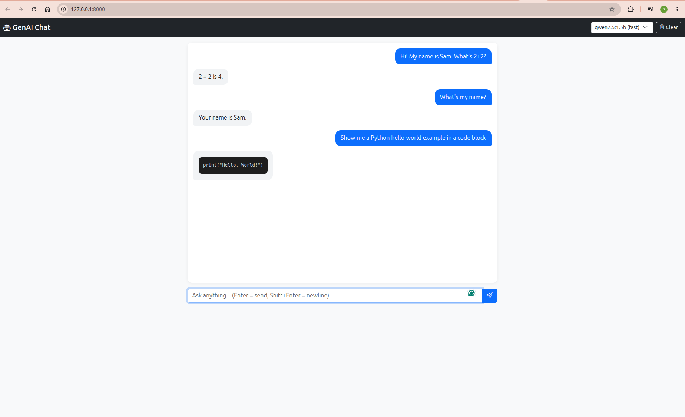

# GenAI Chat 🚀

A minimal, fully local **GenAI chat application** built with **FastAPI** (backend),
**Bootstrap 5** (frontend), and **Ollama** (LLM runtime).

Runs entirely on your machine — no cloud, no API keys, no cost.


<!-- TODO: add a screenshot at docs/screenshot.png -->

## Features

- 📡 **Streaming responses** via Server-Sent Events (SSE) — tokens appear one by one
- 💬 **Multi-turn memory** — last 10 turns of history are sent with each request
- 🎨 **Markdown + code block rendering** — with DOMPurify XSS sanitization
- 🔀 **Dual-model selector** — swap between a fast and a quality model per message
- 🛡️ **Per-IP rate limiting** — 20 requests / 60 seconds
- 🔒 **Env-driven config** — swap LLM provider without code changes
- 🧱 **Isolated virtualenv** — outside the repo, one venv per app
- 🐍 **Python 3.14 compatible** — pinned to versions with prebuilt wheels

## Tech Stack

| Layer | Choice | Why |
|-------|--------|-----|
| Backend | FastAPI 0.115 | Async, auto-docs, native SSE streaming |
| Server | Uvicorn 0.32 | ASGI, hot-reload |
| LLM runtime | Ollama | Local, free, no API key |
| LLM client | `openai` SDK ≥ 2.7.2 | Ollama exposes OpenAI-compatible `/v1` |
| Validation | pydantic ≥ 2.13 | Python 3.14 wheels available |
| Config | python-dotenv | Simple `.env` loading |
| Frontend | Bootstrap 5 + vanilla JS | No build step, CDN-only |
| Markdown | marked + DOMPurify | Client-side rendering, XSS-safe |

---

## 📋 Table of Contents

1. [System Requirements](#1-system-requirements)
2. [Project Layout](#2-project-layout)
3. [Installation](#3-installation)
4. [Configuration](#4-configuration)
5. [Running the App](#5-running-the-app)
6. [Smoke Tests](#6-smoke-tests)
7. [Daily Workflow](#7-daily-workflow)
8. [API Reference](#8-api-reference)
9. [Troubleshooting](#9-troubleshooting)
10. [Design Decisions](#10-design-decisions)
11. [Roadmap](#11-roadmap)

---

## 1. System Requirements

**Tested environment** (all commands below are verified on this exact setup):

| Item | Value |
|------|-------|
| OS | Ubuntu 26.04.1 LTS (also works on macOS, WSL2) |
| Laptop | Lenovo ThinkPad E14 Gen 5 |
| CPU | 13th Gen Intel® Core™ i7-1355U (10 cores / 12 threads) |
| RAM | 16 GiB |
| Python | **3.14.4** (min 3.10, but 3.14 requires the pinned versions below) |
| pip | 25.1.1+ |
| git | 2.53.0+ |
| Ollama | Latest (running on `:11434`) |

**Required software:**

- **Python 3.10+** — [python.org](https://www.python.org/downloads/) or `apt`
- **Ollama** — [ollama.com/download](https://ollama.com/download)
- **git** — usually preinstalled

**Python version caveat:**

> ⚠️ On **Python 3.14**, you **must** use the pinned versions in `requirements.txt`.
> Older `pydantic` (< 2.13) and `openai` (< 2.7.2) lack prebuilt wheels for 3.14 and
> will fail to install. If you're on 3.12 or lower, older versions also work.

---

## 2. Project Layout

```
<parent folder>/
├── genai-chat/                        # ← this repo
│   ├── app/
│   │   ├── __init__.py
│   │   ├── config.py                  # env-loaded settings
│   │   ├── schemas.py                 # pydantic request/response models
│   │   ├── llm.py                     # provider-agnostic LLM wrapper
│   │   ├── main.py                    # FastAPI app + endpoints
│   │   └── static/
│   │       ├── index.html             # Bootstrap layout
│   │       ├── style.css              # chat bubbles, code blocks
│   │       └── app.js                 # SSE consumer + markdown renderer
│   ├── requirements.txt
│   ├── .env                           # local secrets — never commit
│   ├── .gitignore
│   ├── README.md
│   └── test_llm.py                    # one-off connectivity smoke test
└── venvs/
    └── venv_genai-chat/               # virtualenv lives OUTSIDE the repo
        ├── bin/activate
        └── lib/python3.14/site-packages/
```

> 💡 **Why is the venv outside the repo?**
> Cleaner git tree, no `.gitignore` pitfalls, and it lets you host **multiple app venvs
> under one `venvs/` root** — e.g. `venvs/venv_genai-chat/`, `venvs/venv_other-app/`.

---

## 3. Installation

Everything below is copy-paste ready. Adjust paths if your root folder differs.

### 3.1 Install system prerequisites

**Ubuntu / Debian:**

```bash
sudo apt update
sudo apt install -y python3 python3-venv python3-pip git curl
```

**macOS:**

```bash
brew install python@3.12 git curl
# Python 3.14 works too if you have it:
# brew install python@3.14
```

**Verify:**

```bash
python3 --version    # → Python 3.10+ (3.14.4 tested)
pip --version
git --version
```

### 3.2 Install and start Ollama

**Install:**

```bash
curl -fsSL https://ollama.com/install.sh | sh
```

**Start the daemon** (usually auto-starts on Linux):

```bash
# Linux systemd
sudo systemctl status ollama
# If not running:
ollama serve &

# macOS: Ollama.app starts it automatically
```

**Verify the daemon:**

```bash
curl http://localhost:11434/
# → "Ollama is running"
```

**Pull the two required models:**

```bash
ollama pull llama3.2:1b          # 1.3 GB — quality model
ollama pull qwen2.5:1.5b         # 986 MB — fast model
```

**Verify:**

```bash
ollama list
# NAME               ID              SIZE      MODIFIED
# llama3.2:1b        ...             1.3 GB    ...
# qwen2.5:1.5b       ...             986 MB    ...
```

> **Optional — better quality model.** If your machine has ≥ 8 GiB free RAM,
> `ollama pull llama3.1:8b` (4.7 GB) gives noticeably better answers.
> Change `OLLAMA_MODEL=llama3.1:8b` in `.env`. Expect ~10–15 tok/s on CPU.

### 3.3 Create the shared `venvs` folder

```bash
mkdir -p "$HOME/IdeaProjects/Gen AI/venvs"
```

> Replace `$HOME/IdeaProjects/Gen AI` with wherever you cloned the repo.
> **Always quote paths containing spaces.**

### 3.4 Create the virtualenv

```bash
cd "$HOME/IdeaProjects/Gen AI"
python3 -m venv venvs/venv_genai-chat
```

### 3.5 Activate the virtualenv

```bash
source "$HOME/IdeaProjects/Gen AI/venvs/venv_genai-chat/bin/activate"
```

Your prompt should now show `(venv_genai-chat)`.

**Confirm:**

```bash
which python
# → .../venvs/venv_genai-chat/bin/python
python --version
# → Python 3.14.4
pip --version
# → .../venvs/venv_genai-chat/lib/python3.14/site-packages/pip (python 3.14)
```

> ⚠️ If `which python` shows `/usr/bin/python3`, activation **did not take**.
> Re-run the `source ...` command from the correct path.

### 3.6 Upgrade pip inside the venv

```bash
python -m pip install --upgrade pip
```

### 3.7 Install dependencies

```bash
cd "$HOME/IdeaProjects/Gen AI/genai-chat"
pip install -r requirements.txt
```

Expected — no errors, all wheels downloaded (no compilation):

```
fastapi            0.115.0
uvicorn            0.32.0
openai             3.x
pydantic           2.14.x
pydantic_core      2.50.x
pydantic-settings  2.15.x
python-dotenv      ≥ 1.2.2 (or 1.0.1 — a warning is harmless)
```

### 3.8 Verify imports

```bash
python -c "import fastapi, uvicorn, openai, dotenv, pydantic, pydantic_settings; print('✅ Environment ready')"
```

If that prints `✅ Environment ready`, installation is complete.

---

## 4. Configuration

### 4.1 Create `.env`

```bash
cd "$HOME/IdeaProjects/Gen AI/genai-chat"
cat > .env <<'EOF'
# ---- LLM Provider ----
# 'ollama' (default, local, free) or 'openai' (cloud, paid)
LLM_PROVIDER=ollama

# ---- Ollama settings ----
OLLAMA_BASE_URL=http://localhost:11434/v1
OLLAMA_MODEL=llama3.2:1b
OLLAMA_MODEL_FAST=qwen2.5:1.5b

# ---- OpenAI settings (only used if LLM_PROVIDER=openai) ----
OPENAI_API_KEY=
OPENAI_MODEL=gpt-4o-mini
EOF
chmod 600 .env
```

### 4.2 Model selection

| Env var | Default | Size | Use case | Speed (i7-1355U, CPU) |
|---------|---------|------|----------|-----------------------|
| `OLLAMA_MODEL` | `llama3.2:1b` | 1.3 GB | Better answers | ~60–80 tok/s |
| `OLLAMA_MODEL_FAST` | `qwen2.5:1.5b` | 986 MB | Fast iteration | ~80–100 tok/s |

The UI exposes a **model dropdown** in the navbar so you can switch per message.

**Want a better model?** Pull and switch — no code changes:

```bash
ollama pull llama3.1:8b
# edit .env: OLLAMA_MODEL=llama3.1:8b
# restart uvicorn (Ctrl+C, re-run)
```

### 4.3 Switching to OpenAI (cloud fallback)

```env
LLM_PROVIDER=openai
OPENAI_API_KEY=sk-proj-your-real-key-here
OPENAI_MODEL=gpt-4o-mini
```

Get a key: https://platform.openai.com/api-keys
Cost: `gpt-4o-mini` ≈ **$0.15 / 1M input tokens** — a full testing session is < $0.01.

**No code changes needed** — `llm.py` reads `LLM_PROVIDER` and picks the right client.

### 4.4 `.gitignore` (already in repo)

```
venv/
venvs/
__pycache__/
*.pyc
.env
.DS_Store
.idea/
.vscode/
```

**Never commit `.env`.** That's how API keys leak.

---

## 5. Running the App

### 5.1 Activate the venv (every session)

```bash
source "$HOME/IdeaProjects/Gen AI/venvs/venv_genai-chat/bin/activate"
```

### 5.2 Start the dev server

```bash
cd "$HOME/IdeaProjects/Gen AI/genai-chat"
uvicorn app.main:app --reload
```

Expected:

```
INFO:     Uvicorn running on http://127.0.0.1:8000 (Press CTRL+C to quit)
INFO:     Started reloader process
INFO:     Application startup complete.
```

### 5.3 Open in browser

| URL | Purpose |
|-----|---------|
| http://127.0.0.1:8000 | Chat UI |
| http://127.0.0.1:8000/docs | Swagger (interactive API docs) |
| http://127.0.0.1:8000/health | Health check |

**Ctrl+C** stops the server. `--reload` auto-restarts on file changes.

---

## 6. Smoke Tests

Run these **once** after install to verify every layer end-to-end.

### 6.1 LLM connectivity (both models)

```bash
cd "$HOME/IdeaProjects/Gen AI/genai-chat"
python test_llm.py
```

Expected:

```
──── [MAIN] ollama / llama3.2:1b ────
Base URL: http://localhost:11434/v1
✅ SUCCESS
Response:    hello from the model
Tokens used: 32

──── [FAST] ollama / qwen2.5:1.5b ────
Base URL: http://localhost:11434/v1
✅ SUCCESS
Response:    Hello from the model!
Tokens used: 29

==================================================
MAIN model: ✅ OK
FAST model: ✅ OK
```

### 6.2 HTTP endpoint tests

With `uvicorn` running in one terminal, open a second terminal:

```bash
# Health
curl -s http://127.0.0.1:8000/health | python3 -m json.tool
```

Expected:

```json
{
  "status": "ok",
  "provider": "ollama",
  "model": "llama3.2:1b"
}
```

```bash
# Non-streaming chat
curl -s -X POST http://127.0.0.1:8000/api/chat \
  -H "Content-Type: application/json" \
  -d '{"message":"Say hi in 3 words","history":[],"use_fast":true}' \
  | python3 -m json.tool
```

Expected:

```json
{ "reply": "Hello there." }
```

```bash
# Streaming SSE — tokens arrive individually, then [DONE]
curl -N -X POST http://127.0.0.1:8000/api/chat/stream \
  -H "Content-Type: application/json" \
  -d '{"message":"Count 1 to 5","history":[],"use_fast":true}'
```

Expected:

```
data: {"delta": "1"}
data: {"delta": ","}
data: {"delta": " "}
data: {"delta": "2"}
...
data: [DONE]
```

### 6.3 End-to-end UI test

1. Open **http://127.0.0.1:8000/**
2. Type: `Hi! My name is Sam. What's 2+2?`
3. Watch the assistant bubble **stream token by token** with a `▍` cursor
4. Follow-up: `What's my name?` → should reply with **Sam** (multi-turn memory)
5. Try: `Show a Python hello-world in a code block` → syntax-styled code
6. Toggle the **model dropdown** in the navbar → next reply uses the other model
7. Click **🗑 Clear** → chat resets, history clears

---

## 7. Daily Workflow

### 7.1 Recommended shell alias

Add to `~/.bashrc` (or `~/.zshrc`):

```bash
alias ga="source '$HOME/IdeaProjects/Gen AI/venvs/venv_genai-chat/bin/activate' && cd '$HOME/IdeaProjects/Gen AI/genai-chat'"
```

Reload:

```bash
source ~/.bashrc
```

Then every session:

```bash
ga
uvicorn app.main:app --reload
```

### 7.2 Adding a dependency

```bash
pip install <package>
pip freeze | grep -i <package> >> requirements.txt
```

Prefer **pinned versions** (`==`) for reproducibility once stable.

### 7.3 Deactivating

```bash
deactivate
```

---

## 8. API Reference

### `POST /api/chat` — non-streaming

**Request:**

```json
{
  "message": "Explain Python decorators",
  "history": [
    {"role": "user", "content": "Hi"},
    {"role": "assistant", "content": "Hello!"}
  ],
  "use_fast": false
}
```

**Response:**

```json
{ "reply": "Decorators are..." }
```

### `POST /api/chat/stream` — streaming (SSE)

Same request shape. Response is `text/event-stream`:

```
data: {"delta":"Deco"}
data: {"delta":"rators"}
data: {"delta":" are..."}
data: [DONE]
```

**Client example** (fetch + `getReader()`):

```javascript
const resp = await fetch("/api/chat/stream", {
  method: "POST",
  headers: { "Content-Type": "application/json" },
  body: JSON.stringify({ message: "hi", history: [], use_fast: true }),
});
const reader = resp.body.getReader();
const decoder = new TextDecoder();
while (true) {
  const { value, done } = await reader.read();
  if (done) break;
  process(decoder.decode(value, { stream: true }));
}
```

### `GET /health`

```json
{ "status": "ok", "provider": "ollama", "model": "llama3.2:1b" }
```

### Rate limiting

- **20 requests / 60 seconds per IP**
- Exceeding → `429 Too Many Requests`
- In-memory only (resets on uvicorn restart)
- Bump `RATE_LIMIT` in `app/main.py` during local testing

---

## 9. Troubleshooting

### Environment & setup

| Symptom | Cause | Fix |
|---------|-------|-----|
| `python: command not found` | Only `python3` present | Use `python3`, or `sudo apt install python-is-python3` |
| `which python` shows `/usr/bin/python3` | venv not activated | Re-run `source .../bin/activate` |
| `pip --version` shows `/usr/lib/...` | Same — system pip in use | Same fix |
| `ModuleNotFoundError: app` | Wrong cwd | `cd genai-chat` before `uvicorn` |
| `pip install` tries to build from source | Python < 3.14 or wrong wheel | Upgrade to pinned versions |
| `SyntaxWarning: invalid escape sequence` | `python-dotenv` < 1.2.2 | Harmless; upgrade if bothered |
| Path with spaces breaks commands | `"Gen AI"` contains space | **Always quote paths** |

### Ollama

| Symptom | Fix |
|---------|-----|
| `curl localhost:11434` connection refused | `ollama serve &` or `sudo systemctl start ollama` |
| `NotFoundError: model 'X' not found` | `ollama list` → edit `.env` to match exact name |
| First call takes 10–20 s | Model cold start on CPU — normal; subsequent calls fast |
| Very slow | Switch `use_fast: true` or `OLLAMA_MODEL=qwen2.5:1.5b` |
| Out-of-memory | Use smaller model; check `free -h` |

### FastAPI / runtime

| Symptom | Fix |
|---------|-----|
| `RuntimeError: ❌ OPENAI_API_KEY not set` | `.env` missing or `LLM_PROVIDER=openai` without key |
| `ImportError: cannot import name 'stream_reply'` | Old `llm.py` — recreate from repo |
| `AttributeError: 'ChatRequest' has no attribute 'use_fast'` | Old `schemas.py` — recreate |
| `500` with `APIConnectionError` | Ollama not running |
| Port 8000 in use | `uvicorn app.main:app --reload --port 8001` |
| `429 Too Many Requests` | Rate limit from earlier tests — restart uvicorn or bump `RATE_LIMIT` |
| Browser shows `{"message":"...UI not built yet"}` | `index.html` missing — `ls app/static/` |
| Page loads but no styling | CDN blocked — check DevTools → Network |
| Streaming appears all at once | Missing `X-Accel-Buffering: no` header in `main.py` |

### Verify your environment at a glance

```bash
echo "python:  $(which python)"
echo "version: $(python --version)"
echo "pip:     $(pip --version)"
echo "ollama:  $(curl -s http://localhost:11434/ 2>/dev/null || echo 'not running')"
echo "models:  $(ollama list 2>/dev/null | tail -n +2 | awk '{print $1}' | tr '\n' ' ')"
```

---

## 10. Design Decisions

| Decision | Rationale |
|----------|-----------|
| **Ollama as default LLM** | $0 cost, 100% local, no API key, no data leaves machine |
| **OpenAI SDK as client** | Ollama exposes an OpenAI-compatible `/v1` endpoint — one client, two providers |
| **`LLM_PROVIDER` env var** | Swap providers without touching code |
| **venv outside repo** | Clean git tree; supports multiple app venvs under `venvs/` |
| **Pinned deps** | Reproducible across machines and CI; 3.14 wheels guaranteed |
| **SSE over WebSocket** | Plain HTTP, no extra infra, works behind any proxy |
| **In-memory rate limiter** | Zero deps; swap for Redis when scaling beyond one process |
| **Markdown rendered client-side** | Server stays stateless; easier to cache/offload |
| **Two-model setup (main + fast)** | Fast iteration on CPU-only machines; quality when needed |
| **`os.getenv` + `dotenv`** | Trivial to debug; migrate to `BaseSettings` once patterns settle |

---

## 11. Roadmap

### ✅ Done
- [x] Python 3.14-compatible pinned dependencies
- [x] Isolated venv under `venvs/venv_genai-chat`
- [x] Ollama integration — dual-model (main + fast)
- [x] Provider abstraction — swap `ollama` ↔ `openai` via `.env`
- [x] `/api/chat` — non-streaming endpoint
- [x] `/api/chat/stream` — SSE streaming endpoint
- [x] In-memory rate limiter
- [x] Bootstrap 5 UI — markdown + code + typing cursor
- [x] Multi-turn history in browser session
- [x] Model selector in the navbar
- [x] Clear-chat button

### 🚧 Nice to have
- [ ] Persistent chat sessions (SQLite + SQLModel)
- [ ] Streaming abort (Stop button mid-response)
- [ ] Save/load conversation JSON
- [ ] `Dockerfile` + `docker-compose.yml`
- [ ] GitHub Actions CI (lint + tests)

### 🔮 Future enhancements
- [ ] User auth (JWT via `fastapi-users`)
- [ ] RAG over uploaded PDFs (`chromadb` + `nomic-embed-text`)
- [ ] Tool calling (web search, calculator)
- [ ] Observability (Langfuse / LangSmith)
- [ ] Additional providers (Anthropic, Gemini)

---

## 📜 License

MIT — use it, fork it, ship it. No warranty.

---

## 🙏 Acknowledgements

Built with:
[FastAPI](https://fastapi.tiangolo.com/) ·
[Ollama](https://ollama.com/) ·
[Bootstrap](https://getbootstrap.com/) ·
[marked](https://marked.js.org/) ·
[DOMPurify](https://github.com/cure53/DOMPurify)

---

*Last verified: Ubuntu 26.04.1 · Python 3.14.4 · FastAPI 0.115.0 · openai 3.x · pydantic 2.14.x · Ollama (llama3.2:1b + qwen2.5:1.5b)*# genai-chat
